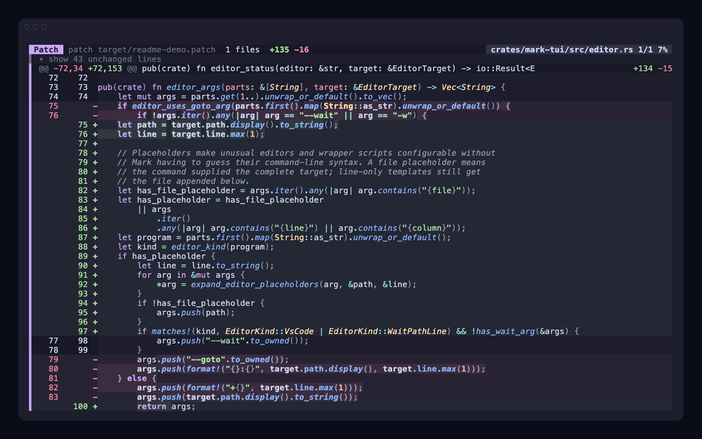

# mark

[](https://github.com/phongndo/mark/actions/workflows/quality.yml)
[](https://github.com/phongndo/mark/releases/latest)
[](LICENSE)

A fast, keyboard-first Git diff reviewer for the terminal.

<p align="center">
  
</p>

Review local changes, commits, patches, pager input, difftool pairs, and pull
requests in one focused interface.

## Install

Mark runs on macOS and Linux, on `aarch64` and `x86_64`.

### Homebrew

```sh
brew install phongndo/tap/mark-cli
```

### Install script

```sh
curl -fsSL https://raw.githubusercontent.com/phongndo/mark/main/scripts/install.sh | sh
```

### mise

```sh
mise use -g github:phongndo/mark
```

mise takes a release as the latest once it's a day old; name a newer version,
such as `github:phongndo/mark@0.15.0`, to get it sooner.

### Nix

Builds the latest `main` for Linux and Apple silicon. With Lix or Nix before
2.30, use `nix profile install`.

```sh
nix profile add github:phongndo/mark
```

Update with `mark update`, however you installed it.
[Updating](docs/usage.md#updating) covers what it runs and pinning a version.

## Quick start

```sh
mark diff                    # local changes
mark compare main            # workspace against main
mark compare main feature    # two revisions
mark show HEAD~1             # one commit
mark review 123              # pull request
mark patch changes.diff      # patch file
git diff | mark pager        # pager input
mark diff --watch            # live reload
```

Run a review command directly; bare `mark` currently exits without opening the
interface.

## Built for review

- Split and unified layouts with syntax highlighting.
- File filtering, diff search, expandable context, and full-file view.
- Inline line, hunk, and file annotations with reviewed-state tracking.
- Stable snapshots by default; continuous reload only with `--watch`.
- Custom themes, keybindings, and editor integration.
- Lazy loading and viewport rendering for large diffs.
- Terminal annotations that return selected notes as plain Markdown.

## Use with an AI agent

Install Mark's native harness package. In Pi, for example:

```sh
pi install npm:mark-pi
```

Run `/mark` to annotate the current worktree diff in the terminal. Add notes,
questions, or requests. **Shift-Q** immediately puts all marks in the chat draft
and closes Mark. Use the **`n` marks list** (`j`/`k`, Space, Ctrl-S) to send some instead.
Edit the chat draft and press Enter when ready; returning marks never auto-sends.
Each invocation starts fresh.

[Harness integrations](docs/integrations.md) covers installation and the
supported experience in Claude Code, Codex, Pi, OpenCode V2, and fx. Command
names and presentation follow each host's available interfaces.

Shell-capable agents can also use the existing JSON session CLI with an
already-open standalone Mark review. See
[live agent sessions](docs/usage.md#live-agent-review-sessions).

## Controls

| Key | Action |
| --- | --- |
| `j` / `k` | Move down / up |
| `[` / `]` | Previous / next hunk |
| `Shift-Tab` / `Tab` | Previous / next file |
| `f` / `/` | Filter files / search the diff |
| `Enter` | Add an annotation |
| `s` | Toggle split / unified layout |
| `r` | Reload |
| `?` | Show all controls |
| `q` | Quit |

Motions accept counts such as `3j`.

## Git integration

Use Mark as a pager:

```sh
git config --global core.pager "mark pager"
```

Use Mark as a difftool:

```sh
git config --global diff.tool mark
git config --global difftool.mark.cmd 'mark difftool -- "$LOCAL" "$REMOTE" "$MERGED"'
```

## Documentation

Mark works without configuration. Run `mark config` to find the config file and
`mark --help` for the complete command list.

[Usage](docs/usage.md) · [Configuration](docs/configuration.md) ·
[Development](docs/development.md) · [Contributing](CONTRIBUTING.md)

## License

[MIT](LICENSE)
